<!-- sgrh-presentation:start -->
<p align="center"><a href="README.es.md" lang="es" hreflang="es"><picture><source media="(prefers-color-scheme: dark)" srcset="docs/assets/readme/lang-es-es-dark.svg"></picture></a> <a href="README.md" lang="en" hreflang="en"><picture><source media="(prefers-color-scheme: dark)" srcset="docs/assets/readme/lang-en-es-dark.svg"></picture></a></p>

<p align="center">
  <a href="srgh-app/README.md"><picture><source media="(prefers-color-scheme: dark)" srcset="docs/assets/readme/nav-start-es-dark.svg"></picture></a>
  <a href="docs/README.md"><picture><source media="(prefers-color-scheme: dark)" srcset="docs/assets/readme/nav-docs-es-dark.svg"></picture></a>
  <a href="docs/arquitectura/vision-general.md"><picture><source media="(prefers-color-scheme: dark)" srcset="docs/assets/readme/nav-architecture-es-dark.svg"></picture></a>
  <a href="docs/guias/testing.md"><picture><source media="(prefers-color-scheme: dark)" srcset="docs/assets/readme/nav-tests-es-dark.svg"></picture></a>
  <a href="https://github.com/2834kendall/Celulares_Alex_Frontend/actions/workflows/ci.yml"><picture><source media="(prefers-color-scheme: dark)" srcset="docs/assets/readme/nav-ci-es-dark.svg"></picture></a>
</p>

<picture><source media="(prefers-color-scheme: dark)" srcset="docs/assets/readme/card-es-dark.svg"></picture>

<!-- sgrh-presentation:end -->

<details>
<summary><b>Leer el contenido como texto</b></summary>

## SGRH — Sistema de Gestión de Recursos Humanos

**Personas. Tiempo. Todo en orden.** Plataforma de gestión del ciclo laboral. Conecta expedientes y contratos con programación, asistencia, nómina y seguimiento de desempeño. Multiempresa, con acceso por roles, permisos y sucursal.

### Módulos

| Área                                                                  | Qué permite gestionar                                                                        |
| --------------------------------------------------------------------- | -------------------------------------------------------------------------------------------- |
| [Expedientes](srgh-app/src/modules/employees/README.md)               | Empleados, contratos, información laboral y documentos.                                      |
| [Asistencia y kiosco](srgh-app/src/modules/attendance/README.md)      | Reconocimiento facial, marcas de jornada, tardías, justificaciones y cola offline de marcas. |
| [Horarios](srgh-app/src/modules/schedules/README.md)                  | Plantillas, jornadas y programación semanal por sucursal.                                    |
| [Ausencias](srgh-app/src/modules/absences/README.md)                  | Registro de permisos, vacaciones, licencias e incapacidades como ausencias aprobadas.        |
| [Nómina](srgh-app/src/modules/payroll/README.md)                      | Planilla quincenal, comprobantes, horas extra, aguinaldo y liquidación.                      |
| [Reclutamiento](srgh-app/src/modules/recruitment/README.md)           | Candidatos, documentos, etapas, criterios de selección y contratación.                       |
| [Evaluaciones](srgh-app/src/modules/evaluations/README.md)            | Rubros, calificaciones, fortalezas, mejoras e historial individual.                          |
| [Dashboard](srgh-app/src/modules/dashboard/README.md)                 | Paneles personalizables y resúmenes según los permisos del usuario.                          |
| [Sucursales y configuración](srgh-app/src/modules/settings/README.md) | Ubicaciones, accesos de kiosco, preferencias y apariencia por sucursal.                      |
| [Usuarios y acceso](srgh-app/src/modules/users/README.md)             | Roles, permisos y gestión de cuentas.                                                        |

El flujo de asistencia representa **identificar a la persona y después elegir la marca**: reconocer un rostro no registra una entrada automáticamente. La cola offline de marcas no convierte al reconocimiento facial en un servicio sin conexión.

### Tecnologías

| Capa                   | Tecnologías                                                               |
| ---------------------- | ------------------------------------------------------------------------- |
| Interfaz               | Next.js 16 con App Router, React 19, TypeScript, Tailwind CSS 4 y Lucide. |
| Datos y acceso         | Supabase: PostgreSQL, Auth, Row Level Security y Storage.                 |
| Formularios            | React Hook Form, Zod y protección de cambios sin guardar.                 |
| Visión en el navegador | MediaPipe y face-api.js para el flujo facial del kiosco.                  |
| Documentos y reportes  | PDF-lib y ExcelJS.                                                        |
| Calidad                | Vitest, Testing Library, Playwright y GitHub Actions.                     |
| Herramientas           | pnpm, ESLint, Prettier, Husky, lint-staged y commitlint.                  |

### Acceso y contexto

- **Empresa y sucursal:** información delimitada por la organización y sus ubicaciones.
- **Roles y permisos:** autorización en servidor y políticas RLS en la base de datos.
- **Trazabilidad laboral:** contratos, marcas, documentos y evaluaciones mantienen su relación con el expediente y la operación.

Detalles: [capas de seguridad](docs/arquitectura/capas-de-seguridad.md) y [permisos y roles](docs/arquitectura/permisos-y-roles.md).

### Para empezar

Requisitos: **Node.js ≥ 22.13**, **pnpm** y acceso al entorno de desarrollo. Todos los comandos de la aplicación se ejecutan desde `srgh-app/`.

```bash
cd srgh-app
pnpm install --frozen-lockfile
# Configurar .env.local siguiendo la guía de entorno antes de iniciar.
pnpm dev
```

- [Arranque y comandos](srgh-app/README.md).
- [Variables de entorno y Supabase](docs/guias/entorno-y-supabase.md).
- [Pruebas y calidad](docs/guias/testing.md).
- [Base de datos, migraciones y seeds](srgh-app/supabase/README.md).

### Organización del repositorio

| Carpeta                                             | Contenido                                      |
| --------------------------------------------------- | ---------------------------------------------- |
| [`srgh-app/`](srgh-app/README.md)                   | Aplicación Next.js y módulos de negocio.       |
| [`srgh-app/supabase/`](srgh-app/supabase/README.md) | Migraciones, seeds y documentación de la base. |
| [`docs/`](docs/README.md)                           | Arquitectura, guías y propuestas.              |
| `docs/assets/readme/`                               | Tarjeta SVG clara y oscura.                    |

### Flujo de trabajo

Jira usa la clave `SGRH`. Las ramas `<type>/SGRH-XX-<desc>` salen de **`dev`** y los PR vuelven a `dev`; `main` recibe PR desde `dev`. Commits: `SGRH-XX: <type>(<scope>): <resumen>`. Git técnico en inglés; interfaz y referencias de dominio en español. La presentación y las guías principales tienen versiones en español e inglés. Detalle: [git y calidad](docs/guias/git-y-calidad.md).

### Mantener esta tarjeta

Los SVG son autocontenidos: tipografía Inter Tight y Manrope convertida a trazados, logo incluido y sin JavaScript, fuentes remotas ni imágenes externas. Las fuentes originales y sus licencias OFL están en `docs/assets/readme/fonts/`. Las animaciones representan las etapas de reclutamiento, los datos entre módulos, la programación de turnos, el reconocimiento y la consolidación de la jornada. Los botones son enlaces HTML que envuelven imágenes SVG; funcionan en GitHub sin depender de enlaces internos del SVG. Con `prefers-reduced-motion` se muestra una versión estática; el contenido también se conserva en visores sin animación.

El selector ES/EN cambia la tarjeta, los botones y el contenido. Las guías principales de instalación, documentación, arquitectura y pruebas tienen versiones en ambos idiomas. Las referencias técnicas de dominio conservan su contenido en español.

Para regenerar las variantes y sus vistas previas, instalá primero las dependencias de `srgh-app/` con `pnpm install`. Después, desde la raíz y con Python 3:

```bash
python -m pip install fonttools markdown
python scripts/build_readme_card.py
python scripts/build_readme_pages.py
```

</details>
