<!-- sgrh-presentation:start -->
<p align="center"><a href="README.es.md" lang="es" hreflang="es"><picture><source media="(prefers-color-scheme: dark)" srcset="docs/assets/readme/lang-es-en-dark.svg"></picture></a> <a href="README.md" lang="en" hreflang="en"><picture><source media="(prefers-color-scheme: dark)" srcset="docs/assets/readme/lang-en-en-dark.svg"></picture></a></p>

<p align="center">
  <a href="srgh-app/README.en.md"><picture><source media="(prefers-color-scheme: dark)" srcset="docs/assets/readme/nav-start-en-dark.svg"></picture></a>
  <a href="docs/README.en.md"><picture><source media="(prefers-color-scheme: dark)" srcset="docs/assets/readme/nav-docs-en-dark.svg"></picture></a>
  <a href="docs/arquitectura/vision-general.en.md"><picture><source media="(prefers-color-scheme: dark)" srcset="docs/assets/readme/nav-architecture-en-dark.svg"></picture></a>
  <a href="docs/guias/testing.en.md"><picture><source media="(prefers-color-scheme: dark)" srcset="docs/assets/readme/nav-tests-en-dark.svg"></picture></a>
  <a href="https://github.com/2834kendall/Celulares_Alex_Frontend/actions/workflows/ci.yml"><picture><source media="(prefers-color-scheme: dark)" srcset="docs/assets/readme/nav-ci-en-dark.svg"></picture></a>
</p>

<picture><source media="(prefers-color-scheme: dark)" srcset="docs/assets/readme/card-en-dark.svg"></picture>

<!-- sgrh-presentation:end -->

<details>
<summary><b>Read the content as text</b></summary>

## SGRH — Human Resource Management System

**People. Time. All in order.** A multi-company workforce management platform. It connects employee records and contracts with scheduling, attendance, payroll and performance follow-up. Access is scoped by company, branch, role and permission.

### Modules

Detailed domain references linked in this table are currently in **Spanish**.

| Area                                                              | What it manages                                                                       |
| ----------------------------------------------------------------- | ------------------------------------------------------------------------------------- |
| [Employee records](srgh-app/src/modules/employees/README.md)      | Employees, contracts, employment data and documents.                                  |
| [Attendance and kiosk](srgh-app/src/modules/attendance/README.md) | Face recognition, time punches, lateness, justifications and an offline punch queue.  |
| [Scheduling](srgh-app/src/modules/schedules/README.md)            | Templates, working hours and weekly shifts by branch.                                 |
| [Absences](srgh-app/src/modules/absences/README.md)               | Leave, vacation and medical absence records, saved as approved by an authorized user. |
| [Payroll](srgh-app/src/modules/payroll/README.md)                 | Twice-monthly payroll, payslips, overtime, annual bonus and final settlement.         |
| [Recruitment](srgh-app/src/modules/recruitment/README.md)         | Applicants, documents, stages, selection criteria and hiring.                         |
| [Evaluations](srgh-app/src/modules/evaluations/README.md)         | Criteria, ratings, strengths, areas for improvement and individual history.           |
| [Dashboard](srgh-app/src/modules/dashboard/README.md)             | Customizable dashboards and summaries based on user permissions.                      |
| [Branches and settings](srgh-app/src/modules/settings/README.md)  | Locations, kiosk access, preferences and branch appearance.                           |
| [Users and access](srgh-app/src/modules/users/README.md)          | Roles, permissions and accounts.                                                      |

The attendance illustration shows **identifying the person and then choosing a punch**: recognizing a face does not automatically clock someone in. The offline punch queue does not make face recognition an offline service.

### Technology

| Layer                 | Technologies                                                            |
| --------------------- | ----------------------------------------------------------------------- |
| Interface             | Next.js 16 App Router, React 19, TypeScript, Tailwind CSS 4 and Lucide. |
| Data and access       | Supabase: PostgreSQL, Auth, Row Level Security and Storage.             |
| Forms                 | React Hook Form, Zod and unsaved-change protection.                     |
| Browser vision        | MediaPipe and face-api.js for the kiosk's facial flow.                  |
| Documents and reports | PDF-lib and ExcelJS.                                                    |
| Quality               | Vitest, Testing Library, Playwright and GitHub Actions.                 |
| Tooling               | pnpm, ESLint, Prettier, Husky, lint-staged and commitlint.              |

### Access and context

- **Company and branch:** data is scoped to its organization and locations.
- **Roles and permissions:** server authorization and database RLS policies enforce access.
- **Employment history:** contracts, punches, documents and evaluations retain their relationship to the employee and operation.

Technical details in Spanish: [security layers](docs/arquitectura/capas-de-seguridad.md) and [permissions and roles](docs/arquitectura/permisos-y-roles.md).

### Getting started

Requires **Node.js ≥ 22.13**, **pnpm** and access to the development environment. Run application commands from `srgh-app/`.

```bash
cd srgh-app
pnpm install --frozen-lockfile
# Configure .env.local using the environment guide before starting.
pnpm dev
```

- [Setup and commands](srgh-app/README.en.md).
- [Documentation index](docs/README.en.md).
- [Architecture](docs/arquitectura/vision-general.en.md).
- [Testing and quality](docs/guias/testing.en.md).
- [Environment and Supabase — Spanish](docs/guias/entorno-y-supabase.md).
- [Database, migrations and seeds — Spanish](srgh-app/supabase/README.md).

### Repository structure

| Directory                                           | Contents                                                |
| --------------------------------------------------- | ------------------------------------------------------- |
| [`srgh-app/`](srgh-app/README.en.md)                | Next.js application and business modules.               |
| [`srgh-app/supabase/`](srgh-app/supabase/README.md) | Database migrations, seeds and documentation (Spanish). |
| [`docs/`](docs/README.en.md)                        | Architecture, guides and proposals.                     |
| `docs/assets/readme/`                               | Shared artwork, language variants and font licenses.    |

### Workflow

Jira uses the `SGRH` key. Branches named `<type>/SGRH-XX-<description>` start from **`dev`** and PRs target `dev`; `main` receives PRs from `dev`. Commit format: `SGRH-XX: <type>(<scope>): <summary>`. Technical Git messages are in English; the application and domain documentation are in Spanish. [Git and quality guide — Spanish](docs/guias/git-y-calidad.md).

### Maintaining this presentation

The SVGs are self-contained: Inter Tight and Manrope lettering is converted to paths, the original logo is included, and there is no JavaScript or remote asset dependency. Original fonts and OFL licenses are in `docs/assets/readme/fonts/`. Animations illustrate recruitment stages, data connections, scheduling, recognition and workday consolidation. HTML links wrap SVG button images, so navigation works in GitHub image mode. Reduced-motion preferences use a static presentation.

Spanish and English have separate Markdown files and artwork. Language links work on GitHub without JavaScript. Primary setup, documentation, architecture and testing guides are available in both languages; detailed domain references remain in Spanish and are labeled accordingly.

To regenerate artwork and local previews, first install the application dependencies with `pnpm install` in `srgh-app/`. Then run from the repository root:

```bash
python -m pip install fonttools markdown
python scripts/build_readme_card.py
python scripts/build_readme_pages.py
```

</details>
