<!-- sgrh-presentation:start -->
<p align="center"><a href="README.md" lang="es" hreflang="es"><picture><source media="(prefers-color-scheme: dark)" srcset="assets/readme/lang-es-en-dark.svg"></picture></a> <a href="README.en.md" lang="en" hreflang="en"><picture><source media="(prefers-color-scheme: dark)" srcset="assets/readme/lang-en-en-dark.svg"></picture></a></p>

<p align="center">
  <a href="../README.md"><picture><source media="(prefers-color-scheme: dark)" srcset="assets/readme/nav-home-en-dark.svg"></picture></a>
  <a href="../srgh-app/README.en.md"><picture><source media="(prefers-color-scheme: dark)" srcset="assets/readme/nav-start-en-dark.svg"></picture></a>
  <a href="arquitectura/vision-general.en.md"><picture><source media="(prefers-color-scheme: dark)" srcset="assets/readme/nav-architecture-en-dark.svg"></picture></a>
  <a href="guias/testing.en.md"><picture><source media="(prefers-color-scheme: dark)" srcset="assets/readme/nav-tests-en-dark.svg"></picture></a>
  <a href="https://github.com/2834kendall/Celulares_Alex_Frontend/actions/workflows/ci.yml"><picture><source media="(prefers-color-scheme: dark)" srcset="assets/readme/nav-ci-en-dark.svg"></picture></a>
</p>

<picture><source media="(prefers-color-scheme: dark)" srcset="assets/readme/header-docs-en-dark.svg"></picture>

<!-- sgrh-presentation:end -->

# SGRH documentation

<!-- sgrh-visual:start -->

<picture><source media="(prefers-color-scheme: dark)" srcset="assets/readme/diagram-docs-en-dark.svg"></picture>
<!-- sgrh-visual:end -->

Project-wide documentation lives here. Domain rules stay next to their code in `srgh-app/src/modules/<module>/README.md`.

## Main guides

| Guide                                                      | Contents                                            |
| ---------------------------------------------------------- | --------------------------------------------------- |
| [Application setup](../srgh-app/README.en.md)              | Requirements, development environment and commands. |
| [Architecture overview](arquitectura/vision-general.en.md) | Stack, business modules, directories and routing.   |
| [Testing](guias/testing.en.md)                             | Conventions, coverage, real SQL and CI.             |

## Domain references

<!-- sgrh-section-visual:modules:start -->

<picture><source media="(prefers-color-scheme: dark)" srcset="assets/readme/diagram-modules-en-dark.svg"></picture>
<!-- sgrh-section-visual:modules:end -->

These detailed references are currently in **Spanish**. Their review status is carried over from the Spanish documentation index.

| Area                                  | Reference                                                    | Status               |
| ------------------------------------- | ------------------------------------------------------------ | -------------------- |
| Employee records                      | [employees](../srgh-app/src/modules/employees/README.md)     | Documented           |
| Payroll                               | [payroll](../srgh-app/src/modules/payroll/README.md)         | Documented           |
| Authentication                        | [auth](../srgh-app/src/modules/auth/README.md)               | Documented           |
| Users                                 | [users](../srgh-app/src/modules/users/README.md)             | Documented           |
| Files                                 | [storage](../srgh-app/src/modules/storage/README.md)         | Documented           |
| Settings, branches and kiosks         | [settings](../srgh-app/src/modules/settings/README.md)       | Documented           |
| Field encryption                      | [crypto](../srgh-app/src/lib/crypto/README.md)               | Documented           |
| Shared interface and brand            | [UI components](../srgh-app/src/components/ui/README.md)     | Documented           |
| Database, RLS, migrations and backups | [database](../srgh-app/supabase/README.md)                   | Documented           |
| Attendance and kiosk                  | [attendance](../srgh-app/src/modules/attendance/README.md)   | Owner review pending |
| Scheduling                            | [schedules](../srgh-app/src/modules/schedules/README.md)     | Owner review pending |
| Absences                              | [absences](../srgh-app/src/modules/absences/README.md)       | Owner review pending |
| Recruitment                           | [recruitment](../srgh-app/src/modules/recruitment/README.md) | Owner review pending |
| Evaluations                           | [evaluations](../srgh-app/src/modules/evaluations/README.md) | Owner review pending |
| Dashboard                             | [dashboard](../srgh-app/src/modules/dashboard/README.md)     | Owner review pending |

## Architecture references

Except for the overview, these references are in Spanish.

| Reference                                                 | Contents                                                                 |
| --------------------------------------------------------- | ------------------------------------------------------------------------ |
| [Overview](arquitectura/vision-general.en.md)             | Stack, module structure, folders and routing.                            |
| [Security layers](arquitectura/capas-de-seguridad.md)     | Proxy, guards, RLS, `usePermisos`, Server Actions and policy principles. |
| [Authentication and JWT](arquitectura/auth-y-jwt.md)      | Auth and business users, token claims, helpers and session refresh.      |
| [Permissions and roles](arquitectura/permisos-y-roles.md) | Access model, roles and adding permissions.                              |
| [Performance](arquitectura/rendimiento.md)                | Serial requests, `Promise.all`, refreshes and cached catalogs.           |
| [PostgreSQL errors](arquitectura/errores-postgres.md)     | SQLSTATE codes and user-facing errors.                                   |

## Proposals

[Public recruitment portal — Spanish](propuestas/portal-reclutamiento.md): pending a decision; no implementation.

## Development guides

Except for testing, these references are in Spanish.

| Reference                                               | When to use it                                                     |
| ------------------------------------------------------- | ------------------------------------------------------------------ |
| [New module](guias/nuevo-modulo.md)                     | Adding a module or feature.                                        |
| [Data and forms](guias/datos-y-formularios.md)          | Reads, writes, Zod, React Hook Form and unsaved-change protection. |
| [Git and quality](guias/git-y-calidad.md)               | Branches, commits, PRs, hooks, Prettier and CRLF.                  |
| [Testing](guias/testing.en.md)                          | Test conventions, coverage, real SQL and CI.                       |
| [Environment and Supabase](guias/entorno-y-supabase.md) | Environment variables and provisioning a project.                  |

## Maintenance rules

1. **One source for each fact.** Link to it instead of repeating it. Language versions must describe the same behavior and be updated together.
2. **Do not copy SQL or implementation code.** Refer to the function, policy and defining migration. Copied code becomes stale quickly.
3. **Describe current behavior.** Preserve history only when it explains a non-obvious decision; Git, PRs and Jira retain the rest.
4. **Ticket specifications are temporary.** After merging, move lasting rules into the module README and remove the temporary specification.
5. **This repository is public.** Unresolved security findings belong in Jira, not public documentation. Document the lesson after the issue is fixed.
6. **Aim for about 6 KB per document.** Split large module references into `modules/<module>/docs/*.md`, keeping the README as the index. Keep presentation assets outside Markdown bodies.

## Module README structure

```markdown
# Module

## Purpose

Three to five lines and the application routes that use it.

## Business rules

Short present-tense statements that answer user or developer questions.

## Workflows

Only when there are meaningful ordered steps.

## Data

Table or RPC, permission and defining migration.

## Pitfalls

One concise item per previously discovered problem.

## Open questions

Unresolved domain questions.
```

Per-directory `CLAUDE.md` files are local and unversioned. They import the README with `@README.md` and hold agent-only notes.
