<!-- sgrh-presentation:start -->

Contenido en español · <a href="../../README.md" lang="en">English overview</a>

  <a href="../../README.es.md"><picture><source media="(prefers-color-scheme: dark)" srcset="../assets/readme/nav-home-es-dark.svg"></picture></a>
  <a href="../../srgh-app/README.md"><picture><source media="(prefers-color-scheme: dark)" srcset="../assets/readme/nav-start-es-dark.svg"></picture></a>
  <a href="../README.md"><picture><source media="(prefers-color-scheme: dark)" srcset="../assets/readme/nav-docs-es-dark.svg"></picture></a>
  <a href="vision-general.md"><picture><source media="(prefers-color-scheme: dark)" srcset="../assets/readme/nav-architecture-es-dark.svg"></picture></a>
  <a href="../guias/testing.md"><picture><source media="(prefers-color-scheme: dark)" srcset="../assets/readme/nav-tests-es-dark.svg"></picture></a>

<picture><source media="(prefers-color-scheme: dark)" srcset="../assets/readme/header-security-es-dark.svg"></picture>

<!-- sgrh-presentation:end -->

# Auth y JWT con claims propios

Los flujos de login, activación y recuperación están en
[`modules/auth`](../../srgh-app/src/modules/auth/README.md). Acá está cómo se conecta Auth con
el modelo de negocio y qué lleva el token.

## Usuarios de Auth y de negocio

- **Email y contraseña, sin registro público.** Es un sistema interno: RRHH crea e invita a
  cada persona. Google SSO exigiría cuentas corporativas que no siempre existen.
- `auth.users` maneja login y sesiones; el negocio usa `sgrh_usuarios`, ligado por
  `usr_auth_id` (uuid). **`ON DELETE SET NULL`, no `CASCADE`**: borrar el usuario de Auth no
  puede llevarse el historial laboral ni la nómina, que se conservan por razones legales.
- Un trigger `SECURITY DEFINER` crea la fila de `sgrh_usuarios` al crearse el usuario en Auth
  (corre en el contexto de `auth`, sin acceso a `public` de otra forma).

## Por qué claims en el JWT

La RLS necesita saber empresa, empleado y permisos en **cada** consulta.

| opción                            | problema                         |
| --------------------------------- | -------------------------------- |
| consultar la base en cada request | latencia extra en toda operación |
| guardarlo en el frontend          | manipulable por el usuario       |
| **claims en el JWT**              | firmados, sin consultas extra    |

`public.custom_access_token_hook` los inyecta en `app_metadata` al emitir el token:

| claim          | para qué                                                                               |
| -------------- | -------------------------------------------------------------------------------------- |
| `empresa_id`   | aislamiento por empresa en todas las policies                                          |
| `sucursal_ids` | array de sucursales visibles. `NULL` = sin restricción                                 |
| `emp_id`       | "es mío" sin subconsultas anidadas por fila, crítico en tablas grandes como las marcas |
| `rol`          | informativo; **las policies no comparan nombres de rol**                               |
| `permisos`     | array que lee `tiene_permiso()` en memoria, y que usa la UI sin consultar              |

- El hook filtra usuarios activos (`usr_activo = true`) y roles activos
  (`rol_activo = true OR rol_codigo = 'KIOSCO'`); si no hay rol o usuario activo, limpia los
  claims de negocio (`rol: 'SIN_ROL'`, `permisos: []`).
- El hook es `VOLATILE` (Supabase lo exige) y corre como `supabase_auth_admin`, que necesita
  grants explícitos sobre `public`. Sin ellos falla **en silencio** y el token sale sin claims.
- **Activarlo es un paso manual en el Dashboard** que no viaja en las migraciones. Sin él,
  `tiene_permiso()` devuelve `false` para todo y la RLS bloquea todo. Ver
  [pasos manuales](../../srgh-app/supabase/docs/proyectos-y-pasos-manuales.md).

## Helpers que leen el token

`get_empresa_id()`, `get_sucursal_ids()`, `get_emp_id()`, `get_usr_id()`, `get_rol()`,
`tiene_permiso()` y `sucursal_visible()` (`20261127065500_usuarios_acceso_hardening.sql`),
respaldados por `sgrh_private.sesion_activa()`.

- Viven en `public` porque Supabase no permite crear funciones en `auth`.
- Son `STABLE`: Postgres los evalúa una vez por consulta, no por fila, validando en cada
  sentencia que la sesión siga en `auth.sessions`, sin ban, con `usr_activo = true` y
  asignación activa en la empresa del JWT.
- `EXECUTE` revocado de `PUBLIC` y devuelto **solo** a `authenticated`: las policies los
  necesitan, y un usuario anónimo no.

## Consecuencia: permisos nuevos y revocación inmediata

Si cambian los permisos de un rol o una asignación activa, **el usuario tiene que cerrar sesión y
volver a entrar** para recibir permisos nuevos en el token. En cambio, al desactivar un usuario
se revocan sus sesiones de inmediato (`sgrh_revoke_user_sessions`) y `sgrh_sesion_vigente()` +
`sgrh_private.sesion_activa()` cortan tanto el SSR/proxy como la RLS en la siguiente petición,
sin esperar a que expire el JWT.

## Dónde se consume en Next

| archivo                          | uso                                                                                                                                                                    |
| -------------------------------- | ---------------------------------------------------------------------------------------------------------------------------------------------------------------------- |
| `lib/supabase/server.ts`         | cliente de sesión para Server Components y Actions (RLS activa)                                                                                                        |
| `lib/supabase/client.ts`         | cliente de navegador                                                                                                                                                   |
| `lib/supabase/admin.ts`          | `createAdminClient`, con la secret key; se salta la RLS                                                                                                                |
| `lib/supabase/proxy.ts`          | refresco de sesión y validación contra `sgrh_sesion_vigente()`, limpiando cookies localmente si la sesión fue revocada                                                 |
| `lib/auth/session-active.ts`     | `isSessionActive()` y `getActiveSessionClaims()` memoizados con `React.cache` por request                                                                              |
| `lib/auth/require-permission.ts` | guard; valida claims y sesión activa (`getActiveSessionClaims()`), memoizado por request con `React.cache`                                                             |
| `hooks/usePermisos.ts`           | permisos del token para la UI                                                                                                                                          |
