<!-- sgrh-presentation:start -->
<p align="center"><a href="vision-general.md" lang="es" hreflang="es"><picture><source media="(prefers-color-scheme: dark)" srcset="../assets/readme/lang-es-en-dark.svg"></picture></a> <a href="vision-general.en.md" lang="en" hreflang="en"><picture><source media="(prefers-color-scheme: dark)" srcset="../assets/readme/lang-en-en-dark.svg"></picture></a></p>

<p align="center">
  <a href="../../README.md"><picture><source media="(prefers-color-scheme: dark)" srcset="../assets/readme/nav-home-en-dark.svg"></picture></a>
  <a href="../../srgh-app/README.en.md"><picture><source media="(prefers-color-scheme: dark)" srcset="../assets/readme/nav-start-en-dark.svg"></picture></a>
  <a href="../README.en.md"><picture><source media="(prefers-color-scheme: dark)" srcset="../assets/readme/nav-docs-en-dark.svg"></picture></a>
  <a href="../guias/testing.en.md"><picture><source media="(prefers-color-scheme: dark)" srcset="../assets/readme/nav-tests-en-dark.svg"></picture></a>
  <a href="https://github.com/2834kendall/Celulares_Alex_Frontend/actions/workflows/ci.yml"><picture><source media="(prefers-color-scheme: dark)" srcset="../assets/readme/nav-ci-en-dark.svg"></picture></a>
</p>

<picture><source media="(prefers-color-scheme: dark)" srcset="../assets/readme/header-architecture-en-dark.svg"></picture>

<!-- sgrh-presentation:end -->

# Architecture overview

<!-- sgrh-visual:start -->

<picture><source media="(prefers-color-scheme: dark)" srcset="../assets/readme/diagram-architecture-en-dark.svg"></picture>

The diagram shows the session-client path. Administrative operations require their own permission and company checks.
<!-- sgrh-visual:end -->

## Stack

The frontend uses Next.js 16 (App Router), React 19, TypeScript and Tailwind CSS 4. Supabase provides PostgreSQL, Auth, RLS and Storage. There is no separate custom backend: PostgREST, Supabase Auth, database policies, PostgreSQL functions and Next.js Server Actions handle server responsibilities.

**Access protection is enforced in the database.** RLS scopes access by company even when clients call the API directly with the publishable key. See [security layers — Spanish](capas-de-seguridad.md).

**Use a Server Action** for payroll calculations, email, PDF generation and any operation requiring the secret key. The secret key must never reach the browser.

> Key terminology: `anon` is now called **publishable** (`sb_publishable_…`), and `service_role` is called **secret** (`sb_secret_…`). The names change; their privilege levels do not.

## Organize by business domain

<!-- sgrh-section-visual:code:start -->

<picture><source media="(prefers-color-scheme: dark)" srcset="../assets/readme/diagram-code-en-dark.svg"></picture>
<!-- sgrh-section-visual:code:end -->

Code grows by domain (`employees`, `payroll`, `attendance`), rather than technical file type (`forms`, `tables`). Jira work maps to a business module, reducing overlap between developers.

**The rule: `app/` routes; `modules/<domain>/` implements business behavior; `lib/` connects to external services.**

<details>
<summary>Read the folder structure as text</summary>

```text
srgh-app/src/
  app/              App Router routes: guard, load and assemble
  modules/<domain>/
    actions/        Server Actions, one operation per file
    components/     Domain interface components
    hooks/          Domain hooks; move shared hooks to src/hooks/
    lib/            Pure domain logic
    types.ts        Zod schemas and module types
    README.md       Domain rules
  components/       Shared interface and layout
  lib/              Supabase, auth, permissions, storage, crypto, env
  hooks/            Shared hooks, including usePermisos
  types/            Generated database.types.ts; do not edit by hand
```

</details>

A `page.tsx` containing more than roughly 15 lines of JSX or business logic probably belongs in the module's components directory.

## Routing with App Router

The `app/` directory structure defines the URL.

| File           | Responsibility                                                         | Inherited     |
| -------------- | ---------------------------------------------------------------------- | ------------- |
| `page.tsx`     | Makes the directory navigable.                                         | No            |
| `layout.tsx`   | Wraps its page and descendants, persisting between navigations.        | Yes           |
| `loading.tsx`  | Suspense fallback during loading.                                      | Yes           |
| `error.tsx`    | Catches errors below its segment, excluding that segment's own layout. | Yes           |
| `src/proxy.ts` | Runs before requests.                                                  | One root file |

- **Route groups** such as `(auth)` and `(dashboard)` share layouts without adding a URL segment. `/employees` lives in `app/(dashboard)/employees/page.tsx`.
- **Dynamic segments** such as `[id]` pass the URL value to the page.
- **Error and loading boundaries:** the root and dashboard boundaries provide shared coverage. A module adds its own boundary when its criticality or loading time warrants it, rather than by default.

## Further references

The following detailed references are in Spanish.

| Topic                                | Reference                                    |
| ------------------------------------ | -------------------------------------------- |
| Proxy, guards, RLS and `usePermisos` | [Security layers](capas-de-seguridad.md)     |
| Login, JWT and claims                | [Authentication and JWT](auth-y-jwt.md)      |
| Permission and role model            | [Permissions and roles](permisos-y-roles.md) |
| Slow pages                           | [Performance](rendimiento.md)                |
| Adding a module                      | [Module guide](../guias/nuevo-modulo.md)     |
