<!-- sgrh-presentation:start -->
<p align="center"><a href="vision-general.md" lang="es" hreflang="es"><picture><source media="(prefers-color-scheme: dark)" srcset="../assets/readme/lang-es-es-dark.svg"></picture></a> <a href="vision-general.en.md" lang="en" hreflang="en"><picture><source media="(prefers-color-scheme: dark)" srcset="../assets/readme/lang-en-es-dark.svg"></picture></a></p>

<p align="center">
  <a href="../../README.es.md"><picture><source media="(prefers-color-scheme: dark)" srcset="../assets/readme/nav-home-es-dark.svg"></picture></a>
  <a href="../../srgh-app/README.md"><picture><source media="(prefers-color-scheme: dark)" srcset="../assets/readme/nav-start-es-dark.svg"></picture></a>
  <a href="../README.md"><picture><source media="(prefers-color-scheme: dark)" srcset="../assets/readme/nav-docs-es-dark.svg"></picture></a>
  <a href="../guias/testing.md"><picture><source media="(prefers-color-scheme: dark)" srcset="../assets/readme/nav-tests-es-dark.svg"></picture></a>
  <a href="https://github.com/2834kendall/Celulares_Alex_Frontend/actions/workflows/ci.yml"><picture><source media="(prefers-color-scheme: dark)" srcset="../assets/readme/nav-ci-es-dark.svg"></picture></a>
</p>

<picture><source media="(prefers-color-scheme: dark)" srcset="../assets/readme/header-architecture-es-dark.svg"></picture>

<!-- sgrh-presentation:end -->

# Visión general

<!-- sgrh-visual:start -->

<picture><source media="(prefers-color-scheme: dark)" srcset="../assets/readme/diagram-architecture-es-dark.svg"></picture>

El diagrama muestra la ruta con cliente de sesión. Las operaciones administrativas validan sus propios permisos y contexto de empresa.
<!-- sgrh-visual:end -->

## Stack

Next.js 16 (App Router) + React 19 + TypeScript + Tailwind v4 en el frontend; Supabase
(Postgres + Auth + RLS + Storage) como backend completo. No hay un backend propio: lo que haría
un servidor tradicional lo resuelven PostgREST, Supabase Auth, la RLS, las funciones de
Postgres y las Server Actions de Next.

**La seguridad vive en la base de datos.** Aunque el frontend tenga un bug o alguien use la
`publishable key` directo contra la API, la RLS garantiza que nadie vea datos de otra empresa.
Detalle en [capas de seguridad](capas-de-seguridad.md).

**Cuándo hace falta una Server Action** en vez de ir directo a Supabase: cálculo de nómina,
envío de correos, generación de PDFs y toda operación con la `secret key` (nunca en el
navegador).

> Nomenclatura de llaves: `anon` ahora se llama **publishable** (`sb_publishable_…`) y
> `service_role` se llama **secret** (`sb_secret_…`). Mismos privilegios, otro nombre.

## Organización por módulo de negocio

<!-- sgrh-section-visual:code:start -->

<picture><source media="(prefers-color-scheme: dark)" srcset="../assets/readme/diagram-code-es-dark.svg"></picture>
<!-- sgrh-section-visual:code:end -->

El código crece por dominio (`employees`, `payroll`, `attendance`…), no por tipo técnico
(`forms/`, `tables/`). Es una razón de equipo: cada historia de Jira cae en una carpeta, y dos
personas en módulos distintos casi no se pisan.

**Regla de oro: `app/` solo enruta. `modules/<dominio>/` solo razona. `lib/` solo conecta con
el exterior (Supabase, env).**

<details>
<summary>Ver estructura como texto</summary>

```
srgh-app/src/
  app/              rutas (App Router). Páginas delgadas: guard + carga + ensamblado
  modules/<dominio>/
    actions/        Server Actions, una operación de negocio por archivo
    components/     todo lo visual del módulo
    hooks/          hooks del dominio (si lo usan 2+ módulos, sube a src/hooks/)
    lib/            lógica pura del dominio
    types.ts        schemas Zod y tipos del módulo
    README.md       reglas del módulo (ver docs/README.md)
  components/       compartidos (ui/, layout/)
  lib/              supabase/, auth/, permissions/, storage/, crypto/, env
  hooks/            hooks compartidos (usePermisos)
  types/            database.types.ts (generado, no se edita a mano)
```

</details>

Si un `page.tsx` tiene más de ~15 líneas de JSX o lógica, esa lógica probablemente es de
`modules/<dominio>/components/`.

## Routing (App Router)

La estructura de carpetas de `app/` **es** la URL.

| archivo        | función                                                                     | se hereda         |
| -------------- | --------------------------------------------------------------------------- | ----------------- |
| `page.tsx`     | hace navegable la carpeta                                                   | —                 |
| `layout.tsx`   | envuelve la página y sus hijas; persiste entre navegaciones                 | sí                |
| `loading.tsx`  | se muestra vía Suspense mientras carga la página                            | sí                |
| `error.tsx`    | captura errores de esa rama hacia abajo (no los del layout del mismo nivel) | sí                |
| `src/proxy.ts` | corre antes de cada request                                                 | único, en la raíz |

- **Route groups** `(auth)` y `(dashboard)`: comparten layout sin que el paréntesis aparezca
  en la URL. `/employees` vive en `app/(dashboard)/employees/page.tsx`.
- **Segmentos dinámicos** `[id]`: capturan el valor de la URL y lo pasan a la página.
- **Errores y cargas**: `app/error.tsx` (raíz, el único con `<html>`/`<body>` propios) y
  `app/(dashboard)/error.tsx` + `loading.tsx` cubren todo. Un módulo tiene los suyos solo si su
  criticidad o su tiempo de carga lo justifica (p. ej. nómina), no por defecto.

## Dónde seguir

| tema                              | archivo                                     |
| --------------------------------- | ------------------------------------------- |
| Proxy, guard, RLS y `usePermisos` | [capas de seguridad](capas-de-seguridad.md) |
| Login, JWT y claims               | [auth y JWT](auth-y-jwt.md)                 |
| Permisos y roles                  | [permisos y roles](permisos-y-roles.md)     |
| Por qué una página es lenta       | [rendimiento](rendimiento.md)               |
| Crear un módulo nuevo             | [guía](../guias/nuevo-modulo.md)            |
