<!-- sgrh-presentation:start -->

<a href="testing.md" lang="es" hreflang="es"><picture><source media="(prefers-color-scheme: dark)" srcset="../assets/readme/lang-es-en-dark.svg"></picture></a> <a href="testing.en.md" lang="en" hreflang="en"><picture><source media="(prefers-color-scheme: dark)" srcset="../assets/readme/lang-en-en-dark.svg"></picture></a>

  <a href="../../README.md"><picture><source media="(prefers-color-scheme: dark)" srcset="../assets/readme/nav-home-en-dark.svg"></picture></a>
  <a href="../../srgh-app/README.en.md"><picture><source media="(prefers-color-scheme: dark)" srcset="../assets/readme/nav-start-en-dark.svg"></picture></a>
  <a href="../README.en.md"><picture><source media="(prefers-color-scheme: dark)" srcset="../assets/readme/nav-docs-en-dark.svg"></picture></a>
  <a href="../arquitectura/vision-general.en.md"><picture><source media="(prefers-color-scheme: dark)" srcset="../assets/readme/nav-architecture-en-dark.svg"></picture></a>
  <a href="https://github.com/2834kendall/Celulares_Alex_Frontend/actions/workflows/ci.yml"><picture><source media="(prefers-color-scheme: dark)" srcset="../assets/readme/nav-ci-en-dark.svg"></picture></a>

<picture><source media="(prefers-color-scheme: dark)" srcset="../assets/readme/header-tests-en-dark.svg"></picture>

<!-- sgrh-presentation:end -->

# Testing

<!-- sgrh-visual:start -->

<picture><source media="(prefers-color-scheme: dark)" srcset="../assets/readme/diagram-tests-en-dark.svg"></picture>
<!-- sgrh-visual:end -->

Vitest and Testing Library. Run commands from `srgh-app/`.

| Command                                   | What it runs                                                                                                                                |
| ----------------------------------------- | ------------------------------------------------------------------------------------------------------------------------------------------- |
| `pnpm test`                               | Complete test suite.                                                                                                                        |
| `pnpm test:coverage`                      | Coverage for security-critical areas, where 100% is required.                                                                               |
| `pnpm test:coverage:modules`              | Security coverage plus per-module thresholds.                                                                                               |
| `pnpm test:e2e:prepare` + `pnpm test:e2e` | Browser tests and HTTP integration against local Supabase in Docker; see the [E2E reference — Spanish](../../srgh-app/tests/e2e/README.md). |

## Conventions

- Centralize Supabase mocks in `src/test/supabaseMock.ts`: `createSupabaseClientMock` and `createSupabaseAdminClientMock`, including the Auth admin API.
- Modules importing `server-only` fail outside Next.js. In tests, use `vi.mock('server-only', () => ({}))`.
- Test each Server Action for invalid input before permissions/database access, missing permissions, cross-company validation, the successful path and every mapped error branch.

## A test must fail when its protection is removed

When a test claims that an action is rejected, a value is supplied or a write is prevented, temporarily remove the corresponding protection and verify the test fails. A passing test that cannot detect the missing behavior gives false confidence.

Lessons already found in this project:

- `expect.not.objectContaining({ x: expect.anything() })` accepted a missing encryption guard because `anything()` excludes `null`. Check `not.toHaveProperty` instead.
- A form test supplied a complete branch fixture while its real page omitted that value. **A test must not be more generous than the real caller.**
- A SQL test appeared to validate a `CHECK` constraint while RLS filtered the `UPDATE`. **An RLS-filtered write affects zero rows without raising an error.** Use the correct role.

## Coverage

These are configured minimums, not a claim about a new coverage run.

| Area                                                                                                                         | Minimum                  | Configuration              |
| ---------------------------------------------------------------------------------------------------------------------------- | ------------------------ | -------------------------- |
| `modules/auth`, `lib/auth`, `lib/permissions`, `lib/storage`, `lib/crypto`, `hooks/usePermisos`, `components/layout/Sidebar` | 100% in all four metrics | `vitest.config.ts`         |
| `modules/attendance`                                                                                                         | 87% lines / 75% branches | `vitest.modules.config.ts` |
| `modules/dashboard`                                                                                                          | 72% / 64%                | `vitest.modules.config.ts` |
| `modules/recruitment`                                                                                                        | 85% / 77%                | `vitest.modules.config.ts` |
| `modules/evaluations`                                                                                                        | 93% / 86%                | `vitest.modules.config.ts` |

Run `pnpm test:coverage` before finishing changes to an area requiring 100% coverage.

## Tests against real SQL

- **PGlite:** executes actual migration policies under a non-owner role. Storage and relational fixtures load real JWT helpers and pass claims through `auth.jwt()`. Each case rolls back. These fixtures are not the entire schema.
- **Docker (`tests/e2e/`):** runs all migrations and seeds with real Auth, PostgREST and Storage in an isolated local project (`sgrh105-e2e`). Hosted projects are never used for these tests.

## Continuous integration

`.github/workflows/ci.yml` runs lint and type checking, tests in two shards, security and per-module coverage in one instrumented run, and browser/HTTP integration with its own Supabase in Docker. Reports are retained for 14 days. The aggregate **`CI passed`** job depends on every required job.
