<!-- sgrh-presentation:start -->
<p align="center"><a href="README.md" lang="es" hreflang="es"><picture><source media="(prefers-color-scheme: dark)" srcset="../docs/assets/readme/lang-es-en-dark.svg"></picture></a> <a href="README.en.md" lang="en" hreflang="en"><picture><source media="(prefers-color-scheme: dark)" srcset="../docs/assets/readme/lang-en-en-dark.svg"></picture></a></p>

<p align="center">
  <a href="../README.md"><picture><source media="(prefers-color-scheme: dark)" srcset="../docs/assets/readme/nav-home-en-dark.svg"></picture></a>
  <a href="../docs/README.en.md"><picture><source media="(prefers-color-scheme: dark)" srcset="../docs/assets/readme/nav-docs-en-dark.svg"></picture></a>
  <a href="../docs/arquitectura/vision-general.en.md"><picture><source media="(prefers-color-scheme: dark)" srcset="../docs/assets/readme/nav-architecture-en-dark.svg"></picture></a>
  <a href="../docs/guias/testing.en.md"><picture><source media="(prefers-color-scheme: dark)" srcset="../docs/assets/readme/nav-tests-en-dark.svg"></picture></a>
  <a href="https://github.com/2834kendall/Celulares_Alex_Frontend/actions/workflows/ci.yml"><picture><source media="(prefers-color-scheme: dark)" srcset="../docs/assets/readme/nav-ci-en-dark.svg"></picture></a>
</p>

<picture><source media="(prefers-color-scheme: dark)" srcset="../docs/assets/readme/header-start-en-dark.svg"></picture>

<!-- sgrh-presentation:end -->

# SGRH — application

<!-- sgrh-visual:start -->

<picture><source media="(prefers-color-scheme: dark)" srcset="../docs/assets/readme/diagram-setup-en-dark.svg"></picture>
<!-- sgrh-visual:end -->

The Next.js application for the Human Resource Management System. Run all application commands from this directory.

## Stack

Next.js 16 (App Router), React 19, TypeScript and Tailwind CSS 4; Supabase (PostgreSQL, Auth, RLS and Storage); React Hook Form and Zod; Vitest, Testing Library and Playwright; pnpm, Husky, lint-staged and commitlint.

## Quick start

Requires **Node.js ≥ 22.13**, **pnpm** and access to the **development** Supabase project. Obtain the development credentials from the team.

```bash
pnpm install
# Create .env.local using docs/guias/entorno-y-supabase.md.
pnpm supabase:link        # Link the CLI to development.
pnpm dev                  # http://localhost:3000
```

There is no `.env.example`. The [environment guide — Spanish](../docs/guias/entorno-y-supabase.md) lists required variables and their purpose. **If `FIELD_ENCRYPTION_KEY` is lost, encrypted bank account numbers cannot be recovered.**

## Commands

| Command              | Purpose                                                                                                        |
| -------------------- | -------------------------------------------------------------------------------------------------------------- |
| `pnpm dev`           | Development server.                                                                                            |
| `pnpm build`         | Production build.                                                                                              |
| `pnpm test`          | Complete test suite.                                                                                           |
| `pnpm test:coverage` | Security-area coverage, where 100% is required.                                                                |
| `pnpm lint`          | ESLint.                                                                                                        |
| `pnpm tsc --noEmit`  | Type checking.                                                                                                 |
| `pnpm format`        | Prettier; see the [Git and quality guide — Spanish](../docs/guias/git-y-calidad.md) for Windows CRLF behavior. |
| `pnpm supabase:*`    | Database commands; see the [database reference — Spanish](supabase/README.md).                                 |

When a role's permissions change, the user must sign out and sign in again: permissions are carried in the JWT.

## Documentation

- [Documentation index and maintenance rules](../docs/README.en.md).
- [Architecture overview](../docs/arquitectura/vision-general.en.md).
- [Testing guide](../docs/guias/testing.en.md).
- Each module has a Spanish `README.md` beside its source (`src/modules/<module>/README.md`).
- [Database reference — Spanish](supabase/README.md).
