<!-- sgrh-presentation:start -->
<p align="center"><a href="README.md" lang="es" hreflang="es"><picture><source media="(prefers-color-scheme: dark)" srcset="../docs/assets/readme/lang-es-es-dark.svg"></picture></a> <a href="README.en.md" lang="en" hreflang="en"><picture><source media="(prefers-color-scheme: dark)" srcset="../docs/assets/readme/lang-en-es-dark.svg"></picture></a></p>

<p align="center">
  <a href="../README.es.md"><picture><source media="(prefers-color-scheme: dark)" srcset="../docs/assets/readme/nav-home-es-dark.svg"></picture></a>
  <a href="../docs/README.md"><picture><source media="(prefers-color-scheme: dark)" srcset="../docs/assets/readme/nav-docs-es-dark.svg"></picture></a>
  <a href="../docs/arquitectura/vision-general.md"><picture><source media="(prefers-color-scheme: dark)" srcset="../docs/assets/readme/nav-architecture-es-dark.svg"></picture></a>
  <a href="../docs/guias/testing.md"><picture><source media="(prefers-color-scheme: dark)" srcset="../docs/assets/readme/nav-tests-es-dark.svg"></picture></a>
  <a href="https://github.com/2834kendall/Celulares_Alex_Frontend/actions/workflows/ci.yml"><picture><source media="(prefers-color-scheme: dark)" srcset="../docs/assets/readme/nav-ci-es-dark.svg"></picture></a>
</p>

<picture><source media="(prefers-color-scheme: dark)" srcset="../docs/assets/readme/header-start-es-dark.svg"></picture>

<!-- sgrh-presentation:end -->

# SGRH — aplicación

<!-- sgrh-visual:start -->

<picture><source media="(prefers-color-scheme: dark)" srcset="../docs/assets/readme/diagram-setup-es-dark.svg"></picture>
<!-- sgrh-visual:end -->

La aplicación Next.js del Sistema de Gestión de Recursos Humanos. Todos los comandos se corren desde esta carpeta.

## Stack

Next.js 16 (App Router) + React 19 + TypeScript + Tailwind v4 · Supabase (Postgres, Auth,
RLS, Storage) · React Hook Form + Zod · Vitest + Testing Library + Playwright · pnpm · Husky,
lint-staged y commitlint.

## Arranque rápido

Requisitos: Node **≥ 22.13**, pnpm y acceso al proyecto **dev** de Supabase (pedir las llaves
al equipo).

```bash
pnpm install
# crear .env.local con las variables de docs/guias/entorno-y-supabase.md
pnpm supabase:link        # vincula el CLI a dev
pnpm dev                  # http://localhost:3000
```

No hay `.env.example`: la lista de variables, para qué sirve cada una y cuáles son
obligatorias está en la [guía de entorno](../docs/guias/entorno-y-supabase.md). **Si se pierde
`FIELD_ENCRYPTION_KEY`, los números de cuenta son irrecuperables.**

## Comandos

| comando              | qué hace                                                                                                              |
| -------------------- | --------------------------------------------------------------------------------------------------------------------- |
| `pnpm dev`           | servidor de desarrollo                                                                                                |
| `pnpm build`         | build de producción                                                                                                   |
| `pnpm test`          | suite completa                                                                                                        |
| `pnpm test:coverage` | cobertura de las zonas de seguridad (100 % obligatorio)                                                               |
| `pnpm lint`          | ESLint                                                                                                                |
| `pnpm tsc --noEmit`  | type-check                                                                                                            |
| `pnpm format`        | Prettier (en Windows, `format:check` siempre sale rojo por CRLF: ver [git y calidad](../docs/guias/git-y-calidad.md)) |
| `pnpm supabase:*`    | base de datos: ver [`supabase/README.md`](supabase/README.md)                                                         |

Si cambian los permisos de un rol, el usuario tiene que cerrar sesión y volver a entrar: los
permisos viajan en el JWT.

## Documentación

- Índice general y reglas para mantenerla: [`docs/README.md`](../docs/README.md).
- Cada módulo tiene su `README.md` junto al código (`src/modules/<módulo>/README.md`).
- Base de datos: [`supabase/README.md`](supabase/README.md).
