<!-- sgrh-presentation:start -->

Contenido en español · <a href="../../../../README.md" lang="en">English overview</a>

  <a href="../../../../README.es.md"><picture><source media="(prefers-color-scheme: dark)" srcset="../../../../docs/assets/readme/nav-home-es-dark.svg"></picture></a>
  <a href="../../../README.md"><picture><source media="(prefers-color-scheme: dark)" srcset="../../../../docs/assets/readme/nav-start-es-dark.svg"></picture></a>
  <a href="../../../../docs/README.md"><picture><source media="(prefers-color-scheme: dark)" srcset="../../../../docs/assets/readme/nav-docs-es-dark.svg"></picture></a>
  <a href="../../../../docs/arquitectura/vision-general.md"><picture><source media="(prefers-color-scheme: dark)" srcset="../../../../docs/assets/readme/nav-architecture-es-dark.svg"></picture></a>
  <a href="../../../../docs/guias/testing.md"><picture><source media="(prefers-color-scheme: dark)" srcset="../../../../docs/assets/readme/nav-tests-es-dark.svg"></picture></a>

<picture><source media="(prefers-color-scheme: dark)" srcset="../../../../docs/assets/readme/header-modules-es-dark.svg"></picture>

<!-- sgrh-presentation:end -->

# Nómina (`payroll`)

<!-- sgrh-visual:start -->

<picture><source media="(prefers-color-scheme: dark)" srcset="../../../../docs/assets/readme/diagram-payroll-es-dark.svg"></picture>
<!-- sgrh-visual:end -->

## Qué hace

Planilla quincenal de toda la empresa, con la sucursal en cada fila (armada desde la asistencia, corregible por Excel o a mano),
pagos con comprobante y correo, banco de horas extra, aguinaldo y liquidación según el Código
de Trabajo de Costa Rica. Es el módulo más grande del repo: un tercio del código de `src/`.

Rutas: `/payroll`, `/payroll/new`, `/payroll/[id]`, `/payroll/concepts`,
`/payroll/banco-horas`, `/payroll/aguinaldo-liquidacion`, `/comprobante/...`.

## Documentos de este módulo

| tema                                                                                                | archivo                                                |
| --------------------------------------------------------------------------------------------------- | ------------------------------------------------------ |
| Períodos, flujo de la planilla, conceptos, horas, incapacidad, borrado                              | [docs/planilla.md](docs/planilla.md)                   |
| **Foto del contrato**: obligatoria en toda escritura a `sgrh_nomina_detalle`; «base desactualizado» | [docs/foto-del-contrato.md](docs/foto-del-contrato.md) |
| Liquidación: tres pasos, cada rubro y su artículo                                                   | [docs/liquidacion.md](docs/liquidacion.md)             |
| Aguinaldo: a quién se le debe, de dónde sale el monto                                               | [docs/aguinaldo.md](docs/aguinaldo.md)                 |
| Banco de horas: pagar, compensar, revertir                                                          | [docs/banco-de-horas.md](docs/banco-de-horas.md)       |
| Comprobantes, código de verificación, correo                                                        | [docs/comprobantes.md](docs/comprobantes.md)           |

## Reglas de negocio (resumen)

- **La planilla es una foto, no un espejo**: no se mueve sola. Para traer cambios de
  asistencia o de contrato hay que recalcular, y recalcular nunca toca filas pagadas.
- **Editar un contrato no cambia lo ya calculado**: el cambio entra en el próximo período, o
  en el abierto si se recalcula.
- **Las horas extra no se pagan solas**: van al banco de horas.
- **Incapacidad y viáticos no son salario**: no inflan aguinaldo ni cesantía. La licencia de
  maternidad sí lo es.
- **Liquidar es definitivo**, y pagarla es un paso aparte que no recalcula.
- **El aguinaldo y la liquidación se calculan con las quincenas pagadas**, cada una con su
  propio salario, no con el salario de hoy.
- **El selector de marca elige filas, nunca cambia un cálculo**: filtra después de calcular
  ([selector de marca](../settings/docs/contexto-marca.md)).

## Datos

Policies base en `20260101000600_rls_policies.sql`. `NOMINA_READ` lee y `NOMINA_WRITE`
escribe. Las filas de planilla, sus líneas y sus comprobantes se acotan por la sucursal de la
fila (`ndt_sucursal_id IN sucursales_visibles()`, migración `20261117130000`); el encabezado
del período es de la empresa ([planilla](docs/planilla.md#quién-ve-qué)). El propio empleado ve
sus filas, líneas y comprobantes por la rama `get_emp_id()`. Las tablas de cada tema están en
su documento.

## Trampas

- **Fechas: nunca `toISOString()`.** Toda la nómina razona en días calendario de Costa Rica
  (`lib/fechas.ts`). En UTC-6, después de las 18:00 `toISOString()` ya da el día SIGUIENTE:
  un pago marcado el 31 a las 19:00 quedaría en el período del mes siguiente.
- **`router.refresh()` después de una Server Action que revalida es un segundo render.** Si la
  acción llamó a `revalidatePath`, Next ya devuelve la página re-renderizada en la misma
  respuesta, y sumarle `router.refresh()` repite todas las consultas. Payroll todavía los
  tiene: es deuda abierta.
- **La planilla guarda montos, no fórmulas.** Arreglar un cálculo en el código no corrige las
  filas ya guardadas: hay que recalcularlas (para eso existe "recalcular todo").

## Pendiente

Preguntas de dominio sin dueño. Cambian decisiones de producto, así que no hay que inventar la
respuesta:

1. ¿El período se crea al arrancar la quincena o cerca de que termine?
2. ¿Es normal que queden quincenas viejas sin pagar? En dev había 11 períodos en `borrador`
   de feb–dic 2026, que bloquean el cambio de sucursal base de 21 de 55 contratos vigentes.
